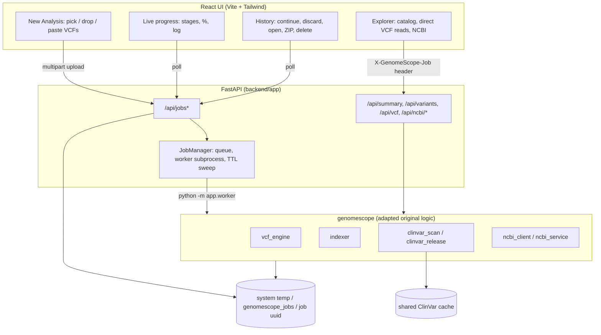

# GenomeScope Architecture

GenomeScope is a full-stack whole-genome-sequencing (WGS) analysis application. A user uploads a single-sample **GRCh38** gVCF (plus optional structural-variant and copy-number VCFs); the backend builds an annotated clinical variant catalog for it in an isolated temp folder, optionally verifies the catalog allele-by-allele against a local ClinVar release, and serves it to a React explorer. Results can be downloaded as a ZIP.

Annotations come from two sources:
- **MyVariant.info (GRCh38)** - used by the catalog builder and by the live resolver for identifiers not yet in the catalog.
- **NCBI live services** - ClinVar, dbSNP, Gene and PubMed via E-utilities (plus NCBI Variation Services for exact allele counts). Every NCBI result is joined with the sample's own genotype read from the gVCF at the same GRCh38 locus.



## Repository Layout
- `backend/app/` - production layer
  - `main.py` - FastAPI app: Trusted-Host / CORS / `no-store` middleware, routers, job-manager lifecycle
  - `config.py` - settings from environment variables and the optional repo-root `.env`
  - `api/jobs.py` - upload, history, logs, discard, delete, ZIP download, `/api/config`
  - `api/explorer.py` - catalog / VCF / NCBI routes (the original API, unchanged behaviour)
  - `api/deps.py` - analysis selection (`X-GenomeScope-Job` header -> workspace activation) and CSRF header check
  - `services/staging.py` - upload validation (VCF signature, sample column, GRCh37 rejection), gzip decompression, canonical file names, manifest
  - `services/analysis.py` - pipeline stages: index, catalog, ClinVar, package (CSV / JSON / ZIP)
  - `services/pipeline.py` - `JobManager`: thread-pool queue, one worker subprocess per job, progress parsing, discard (kill + purge), delete, crash recovery, TTL / orphan sweep
  - `services/job_store.py` - SQLite job registry (`jobs.db` in the jobs root)
  - `services/catalog.py` - catalog queries (summary, filters, 11-field search, live-resolution helpers)
  - `utils/temp_manager.py` - private job folders under the system temp dir; guarded deletes
  - `schemas/job.py` - public job model (internal paths never exposed)
  - `worker.py` - subprocess entry point that runs the stages and reports progress on stdout
- `backend/genomescope/` - core logic adapted from the original prototype
  - `workspace.py` - per-analysis folder layout and the context variable holding the active analysis; `offline_mode()`
  - `vcf_engine.py` - sparse byte-offset index and binary-search reader for the gVCF (every contig indexed, `chr`-prefixed names normalised), SV / CNV parsing; one engine per workspace
  - `indexer.py` - SQLite catalog, MyVariant.info indexing and live resolver (verified TLS), NCBI column migration, upsert rules
  - `alleles.py`, `clinvar_release.py`, `clinvar_scan.py` - ClinVar release download / index and the allele-specific scan
  - `ncbi_client.py`, `ncbi_service.py` - NCBI client (rate limit, cache, retries, circuit breaker) and response builders
- `backend/tests/` - offline test suite on a synthetic genome (`tests/synthetic.py`); see "Testing"
- `frontend/` - React 18 + Vite + Tailwind single-page app (see `docs/FRONTEND.md`)
- `setup.py`, `setup.bat`, `setup.sh` - environment setup; `run.bat`, `run.sh`, `launch.py`, `port.json` - start both servers

## Analysis Lifecycle
1. **Upload** (`POST /api/jobs`, multipart: `snp_indel` required, `sv` / `cnv` optional, `label`, `clinvar_mode` = `off | cached | update`). Files are validated and staged into `<jobs root>/<uuid>/inputs/` as `snp-indel.genome.vcf`, `sv.vcf`, `cnv.vcf` (`.vcf.gz` is decompressed). The original file names are stored only in `inputs/manifest.json` / the job registry for display. Invalid uploads leave nothing behind.
2. **Queue**: the job is `queued` until a worker slot is free (`GENOMESCOPE_MAX_CONCURRENT_JOBS`, default 1).
3. **Worker** (`python -m app.worker`, one subprocess per job) runs the stages and prints `@@STAGE` / `@@RESULT` / `@@ERROR` lines; everything else is appended to `work/pipeline.log`:
   - `index` (5-20 %) - sparse gVCF index
   - `catalog` (20-55 %) - MyVariant.info / mygene.info annotation joined with the gVCF, SV / CNV rows
   - `clinvar` (55-90 %) - allele-specific ClinVar scan + catalog reconciliation (skipped when off or no cached release)
   - `package` (90-100 %) - `variants_catalog.csv`, `carried_variants.csv`, `analysis_summary.json`, ClinVar reports and the log zipped into `archive/genomescope_results.zip`
4. **Completed** analyses open in the explorer; the ZIP is rebuilt on download when the catalog changed afterwards (NCBI import / sync).
5. **Discard** (`POST /api/jobs/{id}/discard`, queued / in-progress only) kills the worker, deletes the job folder and keeps a `discarded` ledger row. **Delete** (`DELETE /api/jobs/{id}`) removes the folder and the ledger row.
6. **Retention**: finished analyses older than `GENOMESCOPE_JOB_TTL_HOURS` (default 168) and orphaned folders older than 6 h are purged by a background sweep; a job that was running when the server stopped is marked `failed` and purged on restart.

Job states: `queued -> in_progress -> completed | failed | discarded`.

### Job folder
```text
<system temp>/genomescope_jobs/          (GENOMESCOPE_JOBS_DIR, mode 0700 on POSIX)
  jobs.db                                job registry
  <job uuid>/
    inputs/   snp-indel.genome.vcf, sv.vcf, cnv.vcf, manifest.json
    work/     genetic_variants.db (catalog + NCBI cache), vcf_sparse_index.json, backups/, pipeline.log
    outputs/  variants_catalog.csv, carried_variants.csv, analysis_summary.json, clinvar_scan_report.json, clinvar_scan_carried.tsv
    archive/  genomescope_results.zip
```

## Jobs API
| Method & path | Notes |
|---|---|
| `POST /api/jobs` | multipart upload; `202` with the job. Requires `X-Requested-With: GenomeScope`. `400` invalid VCF / GRCh37, `413` too large |
| `GET /api/jobs` | all jobs, newest first |
| `GET /api/jobs/{id}` | `{id, label, status, stage, progress, message, created_at, started_at, completed_at, elapsed_seconds, error_message, file_size, files[], options, stages[], result, can_open, can_download}` |
| `GET /api/jobs/{id}/logs?tail=200` | `{job_id, status, lines[]}` |
| `POST /api/jobs/{id}/discard` | queued / in-progress only (`409` otherwise); CSRF header |
| `DELETE /api/jobs/{id}` | `204`; CSRF header |
| `GET /api/jobs/{id}/download-zip` | `application/zip`; `400` unless completed |
| `GET /api/config` | upload limit, TTL, concurrency, cached ClinVar release, upload slots |
| `GET /api/health` | `{status, version, analysis_selected, ncbi}` plus `indexed_variants`, `sample_id`, `reference_genome`, `vcf_files` when an analysis is selected |

Explorer routes (`/api/summary`, `/api/filters`, `/api/variants*`, `/api/vcf/read`, `/api/ncbi/variant|gene|search|import`) require the `X-GenomeScope-Job: <job id>` header (or `?job=`) naming a **completed** analysis: `409` when none is selected or it is not ready, `404` unknown, `410` purged. `/api/clinvar/status` and `/api/ncbi/status` also answer without one.

## Supported Search & Filter Parameters
Users can query or filter across any combination of the following 11 parameters:
1. `rcv_id` - ClinVar RCV accession (e.g., `RCV000000606`, `RCV000014893`)
2. `chr` - Chromosome (`1`-`22`, `X`, `Y`, `MT`)
3. `position` - Genomic coordinate on GRCh38 (exact position `111803962` or range `111800000-111900000`)
4. `variant_id` - dbSNP rsID (e.g., `rs671`, `rs1801133`), Manta SV ID (`MantaDEL:...`), or Canvas CNV ID (`Canvas:LOSS:...`)
5. `gene` - HGNC Gene symbol (e.g., `ALDH2`, `MTHFR`, `BRCA1`, `APOE`, `CFTR`, `HFE`, `CYP2C19`, `SCN1A`)
6. `risk_frequency` - Population risk allele frequency filter (e.g., `<0.01`, `<0.05`, `0.01-0.10`, `>0.10`, or numeric substring)
7. `variant_type` - Variant class (`SNV`, `Indel`, `Deletion`, `Insertion`, `CNV Loss`, `CNV Gain`, `LOH`, `SV Deletion`, `SV Insertion`, `SV Duplication`, `SV Breakend`)
8. `your_status` - Personal genotype status from the VCF (`Detected (Homozygous)`, `Carrier (Heterozygous)`, `Reference (Not Detected)`, `Copy Number Loss`, `Copy Number Gain`, `Loss of Heterozygosity`, `Low Quality / Uncertain`)
9. `condition` - Associated clinical condition, disease, trait, or pharmacogenomic response
10. `classification` - Clinical significance (`Pathogenic`, `Likely Pathogenic`, `Risk Factor`, `Drug Response`, `Association`, `Protective`, `Uncertain Significance`, `Likely Benign`, `Benign`)
11. `evidence` - ClinVar review status / star rating and VCF read quality evidence (`Expert Panel`, `Practice Guideline`, `Multiple Submitters (Strong)`, `Single Submitter (Moderate)`, `Conflicting`, `VCF Read PASS`)

Live resolution: when a `/api/variants` search returns 0 rows and the queried *identifier* (RCV, rsID, VCV, gene symbol, or `chr:position`, also recognised in `q`) is absent from the catalog, the backend first tries the MyVariant.info resolver and, if that adds nothing, imports matching NCBI ClinVar records (see "NCBI Integration"). Free text and condition searches never trigger the NCBI fallback, and other filters returning nothing (e.g. `carried_only`, `classification`) never trigger any catalog writes.

## Returned VCF Read & Clinical Fields
Each returned record includes:
- `variant_id` - Variant identifier (`rsID`, `Canvas:...`, `Manta...`, or coordinate ID)
- `rcv_id` - ClinVar RCV accession(s)
- `chr` & `position` (`end_position` where applicable)
- `gene` - Gene symbol and gene metadata
- `your_data` - Formatted personal genotype alleles from VCF (`G / A (0/1)`) plus read metrics (`DP`, `GQ`, `AD`, `QUAL`, `FILTER`)
- `risk_version` - Risk / alternate allele (`ALT`) vs reference allele (`REF`)
- `risk_frequency` - Population allele frequency (gnomAD / 1000G from MyVariant, or dbSNP study frequency after an NCBI sync/import, e.g. `... [dbSNP ALFA]`)
- `variant_type` - Variant classification type
- `your_status` - Zygosity / carrier status derived from the sample column in the VCF
- `condition` - Clinical condition / phenotype description
- `classification` - Clinical significance classification
- `evidence` - Evidence level, ClinVar review status stars, and VCF sequencing read depth/quality support (suffixed `| NCBI ClinVar VCV...` after an NCBI sync/import)
- `raw_vcf` - Exact VCF fields (`CHROM`, `POS`, `ID`, `REF`, `ALT`, `QUAL`, `FILTER`, `INFO`, `FORMAT`, `SAMPLE`, `source_file`)
- NCBI provenance columns (NULL until a row is synced from / imported via NCBI): `ncbi_variation_id`, `ncbi_last_evaluated`, `ncbi_synced_at` (UTC ISO timestamp), `frequency_source` (e.g. `NCBI dbSNP ALFA`)
- ClinVar-scan provenance columns (NULL until the ClinVar scan stage has verified the row): `clinvar_variation_id`, `clinvar_release`, `clinvar_match`

## ClinVar Release Scan (authoritative catalog verification)

The catalog is first seeded from a filtered MyVariant.info sample joined to the gVCF **by position only**. That can omit rare pathogenic variants absent from the seed sample, and could mark a variant "carried" when the sample has a *different* allele at the same position. The ClinVar stage of the pipeline (`genomescope.clinvar_scan`) replaces that with a complete, allele-specific scan against a local ClinVar release.

### What it does
1. **Release** (`clinvar_release.py`): downloads NCBI's `variant_summary.txt.gz` over verified TLS, checks it against the MD5 NCBI publishes, records the release timestamp (`variant_summary.txt.gz.meta.json`) and builds `clinvar_grch38.db` in the shared ClinVar cache (GRCh38 SNV/indel alleles with VCF-style alleles, RCV map, classification tier, stars). Files: the shared ClinVar cache `GENOMESCOPE_CLINVAR_DIR` (default `%LOCALAPPDATA%/genomescope/clinvar` on Windows, `~/.cache/genomescope/clinvar` elsewhere; public reference data, re-creatable, ~1.2 GB total). Concurrent analyses serialise updates with a lock file. Unexpected ClinVar column layouts fail loudly instead of producing an empty index.
2. **Scan** (`clinvar_scan.scan_gvcf`): one streaming pass over the whole snp-indel gVCF. Every ALT allele present in the genotype is matched to ClinVar by normalised `(chr, pos, deleted, inserted)` (`alleles.normalize_vcf_allele`), so anchor-base differences do not matter. Indels up to 50 bp that are written differently (shifted through a repeat) are matched by reference-free haplotype equivalence (`alleles.alleles_equivalent`); undecidable short cases at Pathogenic / Likely-pathogenic alleles are listed in the report for manual review. A different ALT at the same position never matches.
3. **Coverage**: for every GRCh38 Pathogenic / Likely-pathogenic SNV/indel locus the scan tallies `confirmed_reference` (PASS ref block, depth >= 10), `reference_low_confidence` (block-level minimum depth below 10 or not PASS; conservative, a block's MIN_DP applies to every base in it), `variant_called`, `no_gvcf_record`. "Not carried" is only meaningful for the first group.
4. **Catalog reconciliation** (`reconcile_catalog`): carried findings (tier >= conflicting interpretations; `--include-vus` adds uncertain significance; benign/likely benign are counted, not cataloged) are inserted as `CLINVAR:{chr}:{pos}:VCV{id:09d}` rows or update the existing row for the same ClinVar variation in place (no duplicates). **Every existing snp-indel row is re-adjudicated** with the independent allele-aware reader (`ncbi_service.build_your_genotype`): false carriers are corrected (never deleted), `ref == alt` placeholders repaired, rows whose ClinVar allele cannot be tied to the current release are demoted to `Allele Not Verified` (not carried). The scan and the adjudication are cross-checked; disagreements are reported. Direct VCF reads (`RAW:` rows) make no ClinVar claim and are untouched. Legacy annotation text is not rewritten (it is per-RCV); differences from the release are listed in the report.
5. **Safety**: the catalog DB is backed up first (`<job>/work/backups/`, last 3 kept); post-conditions are checked after writing (every carried non-benign PASS finding has a carried row; no carried row without a verified allele match; no duplicate scan rows) and the exit code is `2` if any fail. Re-running is idempotent.
6. **Outputs**: `<job>/outputs/clinvar_scan_report.json` (summary, coverage, limitations, review list, every corrected row), `clinvar_scan_carried.tsv` (all carried non-benign findings), both included in the results ZIP; table `clinvar_scan_runs` in the catalog, `GET /api/clinvar/status` and the header pill.

### Catalog columns written
`clinvar_variation_id`, `clinvar_release` (ISO date of the ClinVar release used) and `clinvar_match` = `exact` | `equivalent` (carried and verified by the scan) | `low_quality` (call present but not PASS; never carried) | `adjudicated_carried` | `adjudicated_not_carried` | `adjudicated_no_record` | `adjudicated_undecided` | `ncbi_verified` (live-NCBI import, already allele-checked) | `unverified` | `legacy_*` (written by the old position-keyed seeding path, see below). `is_carried = 1` is only set for `exact`, `equivalent`, `adjudicated_carried` or NCBI-verified rows. These are provenance columns: they are never reverted by a non-ClinVar upsert, and `ncbi_*` provenance is not set by the scan.

### Running it
- In the UI choose **Download / refresh the ClinVar release** (first run: ~460 MB download, ~1-2 min indexing, ~3-4 min scan) or **Use the cached ClinVar release** when starting an analysis.
- CLI, for an existing analysis folder (from `backend/`): `python -m genomescope.clinvar_scan --workspace <job_dir> [--update] [--dry-run] [--include-vus] [--rebuild-index] [--summary-file PATH] [--no-backup]`
- Start a new analysis with the refresh option whenever ClinVar publishes a new monthly release; the status pill turns "stale" when the last scan no longer matches the index or the gVCF.

### Limitations (also written into every report)
- Only SNV/indel alleles with a precise GRCh38 VCF representation are matched. Large CNVs, repeat expansions and translocations are counted (`clinvar_not_vcf_representable_by_type`) but not matched; structural variants are covered by the Manta / Canvas files.
- An MNV recorded as one ClinVar allele matches only when the gVCF represents it identically; adjacent SNV calls are not assumed to be the same phased allele.
- Indel equivalence is limited to indels up to 50 bp with overlapping reference spans.
- Classifications are as of the release date and can change. Research-grade WGS calls are not a clinical diagnosis; confirm findings with an accredited laboratory.

### Legacy path guard
`indexer.build_record_from_clinvar_and_vcf` (MyVariant, position-keyed; used when no scan has been run, and by live search resolution) now calls `indexer.legacy_allele_verdict` and never reports `is_carried = 1` unless the ClinVar substitution is one of the called ALTs (`Different ALT Allele (Not the NCBI Variant)` / `Allele Not Verified` otherwise). Indels from this path stay "not carried / unverified" until the scan verifies them.

## NCBI Integration

### Data Sources
| Source | Access | Used for |
|---|---|---|
| ClinVar | E-utilities `esearch` / `esummary` (`db=clinvar`) | Classification (germline, plus somatic oncogenicity / clinical impact when present), review status and stars, last evaluated, RCV accessions, conditions, genes, GRCh38 location, SPDI alleles, molecular consequences, protein change |
| dbSNP | E-utilities `esearch` / `esummary` (`db=snp`) | rsID placement, alleles, SPDI, variant / function class, per-study `global_mafs` frequencies |
| NCBI Variation Services | `https://api.ncbi.nlm.nih.gov/variation/v0/refsnp/{rs}` | Exact per-allele counts when esummary `global_mafs` cannot identify the ClinVar ALT (multi-allelic sites, ambiguous indel naming) |
| Gene | E-utilities `esearch` / `esummary` (`db=gene`, human only) | Symbol, name, summary, aliases, cytoband, GRCh38 span, MIM ids |
| PubMed | E-utilities `elink` (`clinvar_pubmed`, fallback `snp_pubmed_cited`) + `esummary` (`db=pubmed`) | Up to 10 linked publications (newest PMIDs first) |
| Nucleotide (RefSeq) | E-utilities `efetch` (`db=nuccore`, FASTA) | Reference anchor base needed to convert ClinVar indel SPDI to left-aligned VCF alleles (max 6 clustered fetches per request) |
| MedGen / OMIM | Links only (from ClinVar trait xrefs and Gene MIM ids) | Outbound links on condition and gene cards; not queried |

Population frequency studies are preferred in this order: `ALFA`, `GnomAD_genomes`, `TOPMED`, `1000Genomes`, `GnomAD_exomes`, `1000Genomes_30X`, `ExAC`. The reported **risk allele frequency is the frequency of the ClinVar ALT**, not blindly the minor allele: a study reporting the REF allele on a biallelic rsID is converted to `1 - f`, and studies whose reported allele is neither are skipped.

### Endpoints (summary)
All NCBI failures are non-fatal: upstream problems are collected in the response's `errors` list and every body carries `fetched_at` (UTC ISO). Full parameter details are in `docs/NCBI_INTEGRATION.md`.
- `GET /api/ncbi/status` - Live reachability probe: `{reachable, api_key_configured, rate_limit_per_sec, cache_entries, cache_ttl_hours, services: {eutils, variation}, errors, fetched_at}`
- `GET /api/ncbi/variant?rsid=|rcv_id=|vcv_id=|chr=&position=` (+ `include_publications=true`) - One variant across NCBI: `{query, resolved: {chr, position, rsid}, clinvar: [...primary first], dbsnp, gene, publications, your_genotype, risk_allele_frequency: {allele, frequency, study}, links: {clinvar, dbsnp, gene, pubmed}, errors, fetched_at}`
- `GET /api/ncbi/gene/{symbol}?significance=pathogenic|risk|drug|all&limit=40` - Gene panel scan: `{gene, significance, clinvar_total, variants: [{clinvar, your_genotype}], carried_count, errors, fetched_at}`
- `GET /api/ncbi/search?term=&limit=25` - ClinVar search: `{term, translated_query, total, items: [{clinvar, your_genotype}], errors, fetched_at}`
- `POST /api/ncbi/import` (body `{"variation_ids": [...]}`, 1-50 ids, header `X-Requested-With: GenomeScope`) - Import into the catalog: `{imported, record_ids, skipped: [{variation_id, reason}], errors, fetched_at}`
- `GET /api/variants/{record_id}/ncbi` - Read-only NCBI view of a catalog row: the `/api/ncbi/variant` body plus `{record_id, catalog_vs_ncbi: [{field, catalog, ncbi, match}], synced: false}`
- `POST /api/variants/{record_id}/ncbi/sync` (header `X-Requested-With: GenomeScope`) - Same body; writes NCBI values onto the row when allowed (`synced: true`). `GET .../ncbi?sync=true` is rejected with `405` (GETs stay side-effect free).
- `GET /api/health` additionally returns `ncbi: {api_key_configured, cache_entries}`.

### Environment Variables
| Variable | Default | Effect |
|---|---|---|
| `NCBI_API_KEY` | unset | Raises the rate limit from 3 to 10 req/s; sent as `api_key=` on E-utilities requests (never cached as part of the key) |
| `NCBI_EMAIL` | unset | Sent as `email=` on E-utilities requests when set (never hardcoded). `tool=genomescope_wgs_explorer` is always sent |
| `NCBI_CACHE_TTL_HOURS` | `168` (7 days) | TTL of the persistent NCBI response cache |
| `RUN_LIVE_NCBI` | unset | Set to `1` to run the live (real-network) NCBI tests |
| `GENOMESCOPE_CORS_ORIGINS` | local Vite origins (`localhost`/`127.0.0.1` on 5173 and 4173); `launch.py` sets it to the frontend port it picked | Comma list of allowed CORS origins |
| `GENOMESCOPE_BACKEND_PORT` / `GENOMESCOPE_FRONTEND_PORT` | `8000` / `5173` | Read by `frontend/vite.config.js` (proxy target / listen port); set by `launch.py` from `port.json` |
| `GENOMESCOPE_ALLOWED_HOSTS` | `127.0.0.1, localhost, ::1, [::1], testserver` | Comma list for the Host-header allow-list (`*` = any); blocks DNS-rebinding |

### Rate Limiting, Retries & Cache
- **Rate limit**: one global, thread-safe minimum-interval limiter: 3 req/s without a key (with a 1.25x safety margin, ~0.42 s spacing) or 10 req/s with `NCBI_API_KEY` (1.1x margin). An `X-RateLimit-Remaining: 0` header or HTTP 429 puts all threads into a 1 s cooldown.
- **Retries**: up to 3 attempts with exponential backoff (0.5 s x 2^n, honouring `Retry-After` up to 10 s) for 429 / 5xx / transport errors; other 4xx responses are not retried. Timeouts: 15 s read, 3 s connect.
- **Circuit breaker**: after 2 consecutive connection-level failures, requests fail fast for 60 s (serving stale cache when available). `/api/ncbi/status` probes bypass and, on success, close the breaker.
- **Wall-clock budgets**: variant lookup / search / catalog comparison 45 s, gene scan 60 s, import 90 s, `/api/variants` fallback 20 s (single attempt per request).
- **Cache**: SQLite table `ncbi_cache(key, payload, fetched_at)` in the analysis' catalog (`<job>/work/genetic_variants.db`, deleted with the analysis), keyed by URL + sorted params (excluding `api_key`, `email`, `tool`). Entries live for `NCBI_CACHE_TTL_HOURS`; empty esearch results ("not found") expire after 1 hour. When NCBI is unreachable an expired entry is served rather than failing. Import and catalog sync bypass cached responses (fresh fetch, cache refreshed) because they write into the catalog.

### ClinVar Search-Term Translation (`/api/ncbi/search`)
| Input | ClinVar query |
|---|---|
| `RCV000019449` | `RCV000019449` (results filtered to records holding that RCV) |
| `VCV000017865` | `VCV000017865[VACC]` |
| `rs671` | `rs671[VRID]` |
| `12:111803962` / `chr12:111,803,962` | `12[chr] AND 111803962[chrpos38]` |
| Gene-like token (`HFE`, `CYP2C19`) | `"HFE"[gene]`, fallback all-fields |
| Other text | `"<text>"[dis]` (condition), fallback `"word"[All Fields] AND ...` |

Input is sanitised (E-utilities syntax characters stripped, max 200 chars). Later queries run only if earlier ones return nothing. When there are more hits than the ranking pool, 2-4 star records (practice guideline / expert panel / multiple submitters) are pulled in first so established variants are not crowded out by recent entries. Results are ranked: alleles the user carries first, reference-allele (`=`) records after allele-changing ones, simple before haplotype / diplotype records, then classification severity, review stars, and the oldest variation id.

The gene scan applies a significance filter (`pathogenic` = pathogenic + likely pathogenic, `risk` = risk factor / association / protective / affects, `drug` = drug response, `all`) and, for large genes, additionally searches ClinVar at the positions inside the gene where the user's gVCF has a non-reference call (up to 180 positions, gene span <= 3 Mb, up to 100 extra records), so the user's own variants reach the carriers-first ranking.

### Your Genotype vs the NCBI Allele
`your_genotype` (on lookups, search / gene scan items, and the drawer NCBI tab) is read from the analysis' `snp-indel.genome.vcf` at the NCBI GRCh38 locus: `{found, chr, position, ref, alt, genotype, alleles_called, your_status, is_carried, dp, gq, ad, filter, is_reference_block, raw_vcf_line, source_file, carries_ncbi_alt, zygosity_for_ncbi_alt}`.
- Matching is allele-specific: the ClinVar SPDI is compared to every VCF row overlapping the locus (including split rows at the same POS and multi-allelic ALT lists), treating SPDI and left-aligned VCF indel representations as equivalent.
- `carries_ncbi_alt` is `true` (confirmed), `false` (ruled out), or `null` (cannot be decided).
- `zygosity_for_ncbi_alt` values:
  - `homozygous`, `heterozygous` - copies of the NCBI ALT in a diploid call (`carries_ncbi_alt: true`)
  - `hemizygous` (haploid chrX/chrY call), `homoplasmic` (chrMT) - one copy (`true`)
  - `absent` - hom-ref block, or a call without the NCBI ALT (`false`). If the user carries a *different* ALT, `your_status` is `Different ALT Allele (Not the NCBI Variant)`
  - `reference_allele` - ClinVar `=` record (describes the reference allele) and the user has a reference copy (`null`, never counted as carried)
  - `no_call` - `./.` genotype (`null`)
  - `low_quality` - matched row has `FILTER != PASS` (`null`; the row is still shown for inspection)
  - `unknown` - representation could not be decided, or the record is a **haplotype / diplotype / compound record** (`null`): a single-locus read can rule these out but never confirm them, since every member allele and phase would be needed
- Only `carries_ncbi_alt: true` counts as carried (gene scan `carried_count`, carriers-first ranking, frontend highlights, `is_carried` on imported rows).

### Catalog Import & Sync Semantics
- **Import** (`POST /api/ncbi/import`, also used by the `/api/variants` fallback with at most 20 records): ids accept `VCV000017865`, `17865` etc. and are de-duplicated. Records are skipped (with a reason) when the id is invalid, not found / ClinVar unavailable, the record has no GRCh38 location, or the gVCF has no coverage at the locus. For each imported record the user's genotype, the dbSNP risk allele frequency (Variation Services fallback capped per import) and the ClinVar annotation are written. An existing row is updated in place (row id, `rcv_id`, `variant_id`, `chr`, `position` kept) when it already has the same `ncbi_variation_id`, or is an unlinked row at the same locus / source / variant id / ALT that shares an RCV with the record; haplotype / diplotype records never take over a single-variant row. Otherwise a new row is inserted with `unique_key = NCBI:{chr}:{pos}:VCV{9-digit id}`. `is_carried = 1` only for a PASS call of exactly the ClinVar allele.
- **Sync** (`POST /api/variants/{id}/ncbi/sync`): the NCBI lookup prefers the record matching the row's own RCV(s), stored `ncbi_variation_id`, or ALT allele. Sync is refused (reason added to `errors`, starting with `Sync skipped:`) when no ClinVar record resolves, the chosen record is a haplotype / diplotype, the record describes another allele than the row, the user's VCF call is a different ALT, or the row is a structural / copy-number variant (CNV / SV / LOH rows are not single-locus NCBI lookups). A successful sync writes `classification`, `review_status`, `evidence`, `evidence_stars`, `condition` (the catalog text is kept when it already names the NCBI condition or NCBI only offers a generic `<gene>-related genetic phenotype`), `all_rcv_ids`, `ncbi_variation_id`, `ncbi_last_evaluated`, `ncbi_synced_at`, and, when available, `risk_frequency`, `risk_frequency_text`, `frequency_source`.
- **`catalog_vs_ncbi`** compares `allele`, `classification`, `review_status`, `condition`, `rcv_id` and `risk_frequency`; `match` is `true` / `false`, or `null` when NCBI has no value to compare.
- **Upsert protection**: catalog upserts use `INSERT ... ON CONFLICT(unique_key) DO UPDATE` so row ids stay stable. Once a row has `ncbi_synced_at`, a later non-NCBI upsert (MyVariant resolver, catalog rebuild) does not revert the synced fields, and NCBI provenance columns are only changed by NCBI-derived records.
- **Schema migration**: `indexer.ensure_ncbi_columns()` (called from `init_db()`) adds `ncbi_variation_id`, `ncbi_last_evaluated`, `ncbi_synced_at`, `frequency_source` with guarded `ALTER TABLE` and creates `idx_variants_ncbi_vid`, migrating existing databases in place. `ncbi_cache` is created on first use.

## Commands
- Setup: `setup.bat` (Windows) or `./setup.sh` (macOS / Linux) - creates `.venv`, installs `backend/requirements.txt` and the frontend packages, creates `.env` from `.env.example`.
- Run: `run.bat` / `./run.sh` (`--build` serves the production build via `vite preview`, `--no-browser`). The launcher picks the first free port of each list in `port.json`, passes them to Vite (`GENOMESCOPE_BACKEND_PORT`, `GENOMESCOPE_FRONTEND_PORT`) and the backend (`GENOMESCOPE_CORS_ORIGINS`), and stops both servers on Ctrl+C. The Vite dev server listens on localhost only.
- Backend only (from `backend/`): `../.venv/Scripts/python -m uvicorn app.main:app --host 127.0.0.1 --port 8000` (POSIX: `../.venv/bin/python ...`).
- Frontend only (from `frontend/`): `npm run dev` (proxies `/api` to `http://127.0.0.1:8000`), `npm run build`.

## Configuration
See `.env.example`. Notable variables: `NCBI_API_KEY`, `NCBI_EMAIL`, `NCBI_CACHE_TTL_HOURS`, `GENOMESCOPE_OFFLINE`, `GENOMESCOPE_JOBS_DIR`, `GENOMESCOPE_JOB_TTL_HOURS`, `GENOMESCOPE_MAX_UPLOAD_MB`, `GENOMESCOPE_MAX_CONCURRENT_JOBS`, `GENOMESCOPE_CLINVAR_DIR`, `GENOMESCOPE_CORS_ORIGINS`, `GENOMESCOPE_ALLOWED_HOSTS`.

## Testing
From `backend/`: `../.venv/Scripts/python -m pytest` (POSIX: `../.venv/bin/python -m pytest`). The suite is offline and never touches real data: `tests/conftest.py` redirects the jobs root and the ClinVar cache to throw-away temp folders, and every analysis is built from the synthetic genome in `tests/synthetic.py` (fictitious genotypes at public GRCh38 coordinates that line up with the NCBI fixtures).
- `test_api.py` - explorer endpoints, analysis selection, caching headers
- `test_jobs.py` - upload validation / staging, worker stages, full lifecycle through the real worker subprocess (`GENOMESCOPE_OFFLINE=1`), discard / delete / ZIP, TTL and orphan sweep, delete guards
- `test_ncbi.py` - NCBI parsers (public NCBI responses trimmed into `tests/fixtures/ncbi/`), endpoints with a fixture transport, genotype matching; live tests run only with `RUN_LIVE_NCBI=1`
- `test_clinvar_scan.py` - ClinVar release download / MD5 / index, allele-specific scan, coverage, reconciliation, post-conditions, status states (synthetic ClinVar summary + gVCF)
- `test_vcf_engine.py` - sparse index covers small contigs; `chr`-prefixed contigs
